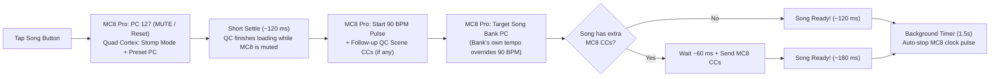
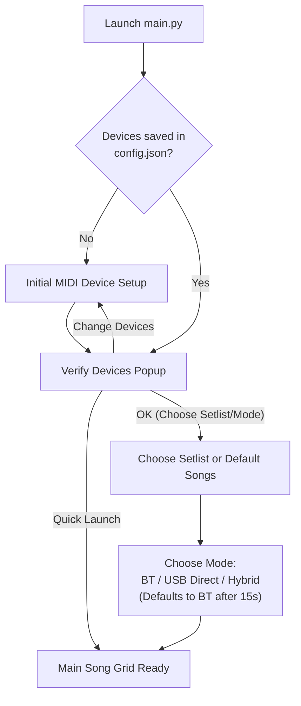
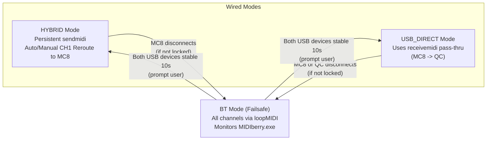

# 🎸 MIDI Patch Sender GUI (`v2.1.4`)

A live-performance desktop app for switching songs on a **Neural DSP Quad Cortex** and **Morningstar MC8 Pro** rig with a single tap. Built for fast, reliable stage use—complete with automatic **USB-to-Bluetooth failover**, **one-click Quick Launch**, **readable Quad Cortex slot names** (like `7C` or `9A`), and **sub-200 ms song loading**.

---

## ✨ What It Does

* **Fast Song Queuing (~120–180 ms):** Streams commands through a persistent `sendmidi.exe` connection so switching songs feels virtually instant instead of taking several seconds.
* **Clean Morningstar Reset + Mute Window:** Briefly hops the MC8 Pro to Bank 128 (`PC 127` / MUTE) while the Quad Cortex loads its new preset in parallel—ensuring the MC8 always resets cleanly (even when two songs share the same bank) and masking preset-switch audio pops.
* **Tempo Sync & Display:** Briefly pulses a default 90 BPM tempo on the MC8 Pro before entering the song's bank (so the MC8 shows the tempo and the QC locks in, while any song bank with its own tempo takes over), then automatically stops the clock pulse in the background after 1.5 seconds.
* **Readable Quad Cortex Patch Names:** Uses `DeviceMIDIMap-MASTER.csv` so your song list can use QC grid names (`7B`, `9A`, `16H`) instead of raw MIDI numbers.
* **One-Click Quick Launch:** Jump straight into your last used mode and setlist on startup, or step through setup whenever you want to change devices or gigs.
* **Stage-Ready Reliability:**
  * **Automatic Failover:** If a required USB device disconnects mid-set, the app alerts you and relaunches in **Bluetooth** mode.
  * **Smart Failback:** If your USB rig reconnects and stays stable for 10 seconds while in BT mode, it prompts to switch back to **USB Direct** or **Hybrid**.
  * **Bluetooth App Monitor:** Watches for `MIDIberry.exe` in BT mode and flashes a red warning if it isn't running.
  * **PANIC!!! Button:** Instantly restarts the app back into your active mode and device, skipping all startup menus.
* **Gig Setlists:** Load your master song library (`MidiList-DEFAULT.csv`) or pick any custom `.txt` setlist from the `Setlist/` folder.

---

## 🔄 Process Workflows

### 1. How a Song Loads (~120–180 ms)

When you tap a song button, the app overlaps the Morningstar reset with the Quad Cortex preset load so everything settles cleanly in one smooth sequence:



### 2. Startup Flow



### 3. Operating Modes & Failover



---

## 🚦 Operating Modes Explained

| Mode | Best For | How Routing Works |
| :--- | :--- | :--- |
| **HYBRID** *(Recommended)* | Fast wired gigs without `receivemidi` | Uses a persistent `sendmidi` pipe. Sends CH2 to the MC8 Pro and CH1 to the QC (or routes CH1 through the MC8 automatically if the QC isn't connected or **Force CH1 Reroute** is checked). Only fails over to BT if the MC8 Pro disconnects. |
| **USB_DIRECT** | Dual-USB rigs needing PC pass-thru | Sends CH1 directly to QC and CH2 to MC8 Pro, and runs `receivemidi.exe` to pass MIDI from the MC8 Pro to the QC. Fails over to BT if either USB device disconnects. |
| **BT (Bluetooth)** | Wireless backup / failsafe | Sends all MIDI channels through `loopMIDI Port` (bridged via `MIDIberry.exe`). Automatically warns if `MIDIberry.exe` isn't running or if the BT port disappears. |

---

## 🛠️ Setup & Requirements

1. **Python 3** with `psutil` installed (for Bluetooth app monitoring):
   ```bash
   pip install psutil
   ```
2. **SendMIDI & ReceiveMIDI** by Geert Bevin ([SendMIDI](https://github.com/gbevin/SendMIDI), [ReceiveMIDI](https://github.com/gbevin/ReceiveMIDI)):
   * Place `sendmidi.exe` in `sendmidi/sendmidi.exe`
   * Place `receivemidi.exe` in `receivemidi/receivemidi.exe`

### Project Layout

```text
sendmidigui2/
├── main.py                     # Entry point & startup flow
├── config.py                   # App defaults, colors, and MIDI timing defaults
├── config.json                 # Auto-generated local device names & timing overrides
├── midi_manager.py             # Persistent SendMIDI engine, ReceiveMIDI, & device monitor
├── utils.py                    # Builds ordered gig CSVs from Setlist/*.txt files
├── gui/
│   ├── app.py                  # Main song-list UI and patch-sending logic
│   └── popups.py               # Startup, Quick Launch, setlist, and mode popups
├── DeviceMIDIMap-MASTER.csv    # Maps Quad Cortex slot names (e.g., 7C) to MIDI PC #s
├── MidiList-DEFAULT.csv        # Master library of all songs and MIDI commands
├── Setlist/                    # Custom gig setlists (.txt)
├── sendmidi/sendmidi.exe       # External MIDI sender
└── receivemidi/receivemidi.exe # External MIDI pass-thru tool (USB_DIRECT mode)
```

---

## 📋 Song Library & Setlists

### Master Song List (`MidiList-DEFAULT.csv`)
Each row creates one song button:

| Column | What It Sets | Example |
| :--- | :--- | :--- |
| **1. Song Label** | Text shown on the button | `Cochise` |
| **2. QC Patch (CH1)** | Quad Cortex slot name (from `DeviceMIDIMap-MASTER.csv`) or raw PC # | `9A` |
| **3. MC8 Bank (CH2)** | Morningstar MC8 Pro bank PC # | `56` |
| **4+ Extra CCs** *(optional)* | Repeatable groups of `Channel, CC#, Value` | `2, 11, 1, 2, 13, 1` |

### Custom Gig Setlists (`Setlist/*.txt`)
Create a plain text file in the `Setlist/` folder for each show:
1. **Line 1:** Display title for the gig (e.g., `STF @ Harborfest`).
2. **Remaining lines:** Song names matching `MidiList-DEFAULT.csv` (case-insensitive, with close-match fallback). The app automatically pins `MUTE`, `DEFAULT (JCM800)`, and `DEFAULT (RVerb)` at the top and `TEST 123` at the bottom.

---

## ⚙️ Tuning Speed & Behavior (`config.json`)

You can fine-tune song-loading timings anytime in `config.json` under `"midi_timing"` (no code edits needed):

| Setting | Default | What It Controls |
| :--- | :--- | :--- |
| `mc8_reset_mode` | `"always_pc127"` | `"always_pc127"` (hops through MUTE every song), `"same_bank_only"` (only hops when staying on the same MC8 bank; otherwise clears toggles with `CC#3=127`), `"cc3_clear"`, or `"none"`. |
| `pc127_settle_ms` | `120` | Wait (ms) after MUTE + QC preset load before switching the MC8 to the target bank. |
| `qc_post_pc_cc_delay_ms` | `120` | Minimum wait (ms) after a QC PC before sending a follow-up QC CC (such as Scene select `CC#43`). |
| `mc8_post_pc_cc_delay_ms` | `60` | Wait (ms) after an MC8 bank PC before firing follow-up MC8 CCs (only used when the song has MC8 CCs). |
| `bt_extra_delay_ms` | `40` | Extra safety cushion (ms) added to settle waits when running over Bluetooth. |
| `clock_reset_mode` | `"mc8_pulse"` | `"mc8_pulse"` (starts MC8 BPM before bank enter, auto-stops in background), `"mc8_stop"`, `"mc8_cc"`, `"midi_clock"`, or `"none"`. |
| `clock_reset_bpm` | `90` | Default BPM used for clock reset. |
| `clock_pulse_ms` | `1500` | How long (ms) the MC8 pulses clock in `"mc8_pulse"` mode before auto-stopping in the background. |
| `button_debounce_ms` | `400` | Minimum time (ms) between song clicks to prevent accidental double-taps. |

---

## 🎛️ Main Window Controls

* **Switch Mode:** Change between **BT**, **USB Direct**, and **Hybrid** on the fly, or relaunch full device setup.
* **List MIDI Devices:** View all MIDI ports currently detected by Windows.
* **Choose Setlist:** Load a different gig setlist without restarting.
* **Force CH1 Reroute (Hybrid):** Routes Quad Cortex (CH1) commands through the Morningstar MC8 Pro even when the QC is plugged in directly.
* **Lock USB/Autoswitch:** Pauses automatic failover/failback popups while still showing live connection status.
* **Debug:** Prints live MIDI batches and load times (in milliseconds) to the console.
* **PANIC!!!:** Immediately restarts the app straight back into your current mode and device.
